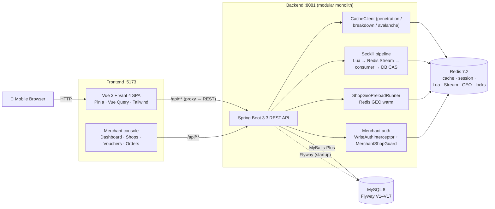

<p align="right"><a href="README.md"><b>English</b></a> | <a href="README.zh-CN.md">简体中文</a></p>

# 🍜 本地生活服务平台 (Local Life Service Platform)

A full-stack **local life service platform** — a Dianping-style app where users browse shops, buy or
flash-sale (seckill) vouchers, and merchants manage their shops, vouchers and redemptions. It is a
**modular monolith**: one Spring Boot application, one MySQL, one Redis, plus a Vue 3 mobile web client.
There is no message queue and no microservice split — deliberately (see [Project Scope](#-project-scope)).

The project has two storylines. The **consumer side** is about caching strategy, high-concurrency
ordering, and distributed coordination. The **merchant side** adds a complete loop of role-based
authorization, shop ownership, voucher management, and order redemption.

> **Public, code-only showcase.** This repository carries the runnable code and the stack. Full
> development history, test artifacts and interview notes live in a private archive.


[](https://github.com/SHADE-glitch/bendi-shenghuo-fuwu-pingtai/actions/workflows/frontend-ci.yml)
[](https://github.com/SHADE-glitch/bendi-shenghuo-fuwu-pingtai/actions/workflows/backend-ci.yml)
[](https://github.com/SHADE-glitch/bendi-shenghuo-fuwu-pingtai/actions/workflows/e2e-fullstack.yml)

**What it is** — A full-stack, Dianping-style local life service platform (Spring Boot modular monolith + Vue 3 mobile web).

**What it solves** — It covers the consumer loop (browse, buy, seckill) and the merchant loop (shop, voucher, redemption), with caching, high-concurrency ordering and distributed coordination.

**How to run** — `docker compose up -d --build`, then open the frontend dev server.

**Where to look** — See [backend/README.md](backend/README.md) for the backend map, and the [Quick Start](#-quick-start) below to run it.

---

## 🛒 Core Business Loop

```
User ──▶ Shop / Voucher ──▶ Seckill ──▶ One order per user ──▶ DB
                            (Redis + Lua)      (idempotency)      ▲
                                    │                              │
                                    └──▶ Async persistence ────────┘
                                         (Redis Stream consumer)
```

A consumer discovers a shop (Redis-cached, GEO for "near me"), opens a voucher, and either buys it
directly or takes part in a flash sale. Seckill requests are gated in Redis by a Lua script (atomic
stock check + one-order-per-user), acknowledged immediately, and persisted asynchronously by a Redis
Stream consumer writing to MySQL. Every later step — pay, cancel, refund, redeem — moves the order
through a CAS state machine.

---

## 🏗️ Architecture



### How the seckill flows

```
Client → seckillVoucher(voucherId)
         │  Validate window (DB SeckillVoucher)
         ├─ Redisson lock per (userId,voucherId)
         ├─ Cold-start / correct Redis stock if stale vs DB
         └─ EVALSHA seckill.lua  KEYS[stock,orders] ARGV[userId]
              → {0 ok, -1 no stock, -2 already claimed}
            ok → XADD seckill:stream {orderId,userId,voucherId}
                 → 200 {orderId, PENDING_PAYMENT}  (async)

Stream consumer (single-thread executor)
  XREADGROUP lastConsumed block 2s → handleStreamRecord
    DB idempotency count(*), CAS stock-1, INSERT order, XACK
  empty poll → XREADGROUP pending 0..  (replay unacked)
```

---

## ✨ Features

| Area | Feature | Notes |
|---|---|---|
| 🏪 | **Shops, categories, details** | Redis-cached with penetration / breakdown / avalanche guards; GEO powers map discovery |
| ⚡ | **Seckill vouchers** | Lua-guarded high-concurrency ordering with async Stream persistence; DB CAS deduction |
| 🎟️ | **Vouchers & orders** | Full lifecycle: browse → purchase / seckill → pay → cancel → refund → delete → redeem (with stock / placeholder rollback) |
| 🧑‍💼 | **Merchant console** | Merchant identity & shop-ownership auth; my shops, shop edit, voucher create (regular / seckill), voucher edit, my vouchers, order query, redemption, dashboard with drill-down |
| 🗺️ | **Map discovery** | AMap-backed map + `ShopGeoPreloadRunner` Redis GEO warmup |
| 📷 | **QR codes** | Generate + scan (`qrcode` + `jsqr`) |
| 📝 | **Blog notes** | Publish / detail (author, shop, comments) / like / my-blog list; aggregated on the shop detail page |
| 💬 | **Shop reviews** | Query by shop / rating summary / create / my reviews / edit / delete |
| 🔔 | **Message notifications** | Message list (like / follow / comment), unread count, mark-as-read / read-all |
| 👥 | **Follow & profiles** | Follow / unfollow / follower list; public profile aggregation (notes + reviews) |
| 🕘 | **Browse history** | Record / my history / clear |
| 📮 | **Feedback** | Submit / my feedback / delete |
| 📅 | **Daily check-in** | BitMap-backed; check-in / streak / today's status |
| 📱 | **Mobile-first SPA** | Vant 4 + Tailwind CSS 4 — home, blog, messages, merchant console, profile, settings |
| 🔐 | **Auth** | Token in Redis (carries `role`), `RefreshTokenInterceptor` + `LoginInterceptor` chain |
| 🖼️ | **File uploads** | `UploadController` → local `uploads/icon` (2 MB, jpg / jpeg / png / webp) |
| 🗃️ | **Schema automation** | Flyway V1–V17 builds the schema + seeds **1,290** shops across 45 cities and 13,601 vouchers (2,682 of them seckill) — no manual SQL |
| 🐳 | **Docker infra** | Full-stack Compose with DevTools hot-reload + Vite HMR |

---

## 🌟 Key Engineering Highlights

Each highlight is framed as **business problem → technical solution → why it was designed this way**.

### 1. Preventing oversell and duplicate orders in the seckill

- **Problem.** A flash sale attracts a burst of concurrent requests at one instant. The stock must not
  go negative, and one user must not end up with two orders.
- **Solution.** A single Lua script (`seckill.lua`) atomically runs `GET stock → SISMEMBER claimed →
  INCRBY -1 → SADD` and returns `0` (ok) / `-1` (no stock) / `-2` (already claimed). Only on `0` does
  the request `XADD` a message to a Redis Stream and return immediately. A single-threaded consumer
  later does the DB write: idempotency `count(userId, voucherId)`, a `stock = stock - 1 WHERE stock > 0`
  CAS, and the `INSERT`. A DB unique key on `(userId, voucherId)` is the final backstop.
- **Why.** The atomic check has to live where the mutable state already is. Lua keeps "read stock,
  check claim, decrement, mark claimed" from interleaving, so the check and the decrement cannot be
  split by another request. The DB CAS and unique key mean that even a stale Redis view cannot produce
  oversell or a duplicate. The synchronous purchase endpoint is deliberately type-checked: a seckill
  voucher cannot be bought there, so it cannot bypass the sale window or the Lua pre-deduction.

### 2. Making the seckill responsive without losing the order

- **Problem.** Synchronous DB writes inside the request thread turn a traffic spike into a wall of
  timeouts and lock contention.
- **Solution.** The request path only touches Redis and returns `200 {orderId, PENDING_PAYMENT}` — accepted asynchronously.
  Persistence is delegated to a **Redis Stream consumer group**: `XREADGROUP` with a consumed-offset,
  `XACK` only after the DB write succeeds, a pending-list sweep (`offset 0`) on empty polls to replay
  un-acked messages, and `XCLAIM`-style re-delivery for messages stuck with a dead consumer. Poison
  messages are isolated so one bad record cannot block the queue.
- **Why.** The Stream is chosen over a general message broker on purpose: stock, Lua, and the stream
  all live in the same Redis, so the hot path is one hop with one failure domain. Delivery guarantees
  (ACK + pending replay) are still there where they matter.

### 3. A reusable cache client that covers penetration, breakdown and avalanche

- **Problem.** Shop and voucher reads hit the same DB under three classic failure modes: queries for
  keys that do not exist (penetration), a hot key expiring under load (breakdown), and many keys
  expiring together (avalanche).
- **Solution.** A single `CacheClient` any service can delegate to:
  `handleCachePenetration` (cache-then-DB, with an empty-value sentinel and `CACHE_NULL_TTL = 2s` to
  kill phantom keys), `handleCacheBreakdownWithMutex` (a Redis lock keyed `lock:shop:{id}` with a 10s
  lease + double-check + blocking retry), `handleCacheBreakdownWithLogicalExpire` (logical expiry via
  `RedisData.expireTime` with async rebuild), and `setWithRandomTtl` (a `0..300s` jitter) to de-sync
  TTLs. Updates delete the cache (cache-aside).
- **Why.** All three modes share one root cause — the DB is unprotected when the cache misses — so a
  single, uniform entry point makes the protection consistent instead of re-implemented per service.

### 4. Every order operation is idempotent and explicit

- **Problem.** Retries are unavoidable on mobile networks; "pay twice", "cancel twice", or replaying a
  seckill message must not corrupt an order.
- **Solution.** Orders move through an explicit state machine
  (`1` pending payment, `2` paid, `3` used, `4` canceled, `5` expired, `6` refunded) via single-row CAS
  updates, so a repeated operation is a no-op once the state has moved. A generic
  `IdempotencyInterceptor` honours an `Idempotency-Key` header by `SETNX`-ing `idem:req:{user}:{method}:{uri}:{key}`
  with a 5-minute TTL and answering `409` on a duplicate. The seckill consumer adds its own
  `count(userId, voucherId)` guard.
- **Why.** Idempotency is expressed as state transitions plus a header contract, so it protects the
  whole API rather than being sprinkled per endpoint.

### 5. Merchant authorization that fails closed

- **Problem.** A merchant must only be able to touch their own shops, vouchers and orders — and a
  missing or malformed session must never be read as "allowed".
- **Solution.** Two independent layers: identity (`tb_user.role`, V15 — `0` consumer / `1` merchant,
  enforced by `WriteAuthInterceptor` on non-GET `/shops/**`, `/vouchers/**`) and ownership
  (`tb_shop.owner_id`, V16, 1:N, enforced by `MerchantShopGuard.assertOwner`). Fail-closed: anonymous →
  `401 + 10001`, non-merchant → `403 + 40003`, cross-shop → `403 + 40004`, and an unauthorized order is
  answered as **"not found"** so existence is not leaked. The frontend route guard is UX only; the
  backend is the boundary.
- **Why.** Identity and ownership are different questions, so they get different checks. Answering
  "not found" instead of "forbidden" removes an enumeration channel.

### 6. Fixing a lock that released before the transaction committed

- **Problem.** In an early implementation the distributed lock was released at the end of the method,
  which could be *before* the surrounding DB transaction committed — a second request could then read
  pre-commit state. (Tracked as `UF-004`.)
- **Solution.** Release the lock from a `TransactionSynchronization.afterCompletion` callback, so it is
  only released after the transaction actually resolves.
- **Why.** "Hold the lock until the work it protects is durable" is the whole point of the lock; tying
  release to transaction completion is the only way to guarantee it. The same boundary governs stock
  compensation: cancel/refund compensation is registered on `afterCommit`, runs `INCR` and `SREM` in
  one Lua script, uses a `SET NX` marker so a replay cannot add stock twice, and falls back to a
  dead-letter list after bounded retries.

### 7. Fast "shops near me" without hammering the DB

- **Problem.** A map view filters shops by category and city and sorts by distance, which is expensive
  to compute per request from a relational table.
- **Solution.** `ShopGeoPreloadRunner` (`ApplicationRunner`) fans every `tb_shop(x, y)` into Redis GEO
  members keyed `shop:geo:{typeId}:{city}` at startup. The map page runs a radius query (50 km) with
  distance sorting and pagination; a request that misses the warm set degrades to a Haversine scan over
  the DB path.
- **Why.** The access pattern is "read-mostly, filter by category + city", which is exactly what a
  pre-warmed geo index serves well, with a correctness-preserving fallback when the cache is cold.

---

## 🧰 Tech Stack

| Layer | Technologies |
|---|---|
| **Backend** | Java 17 · Spring Boot 3.3.5 · MyBatis-Plus 3.5.7 · Flyway (V1–V17) · Redisson 3.37.0 (`RLock.tryLock`) · Hutool 5.8.40 · Lombok · Spring Actuator · Micrometer Prometheus · JaCoCo 0.8.13 |
| **Storage** | MySQL 8 (business data) · Redis 7.2 (cache / Stream `SECKILL_STREAM_KEY` / GEO `SHOP_GEO_KEY` / session tokens / locks; AOF enabled) |
| **Frontend** | Vue 3.5 · TypeScript 6.0 · Vite 8 · Vant 4.9 · Tailwind CSS 4 · Pinia 3 (+ persistedstate) · Vue Router 5 · TanStack Vue Query 5 · Axios · `qrcode` / `jsqr` |
| **Testing** | Backend: JUnit 5 · AssertJ · MockMvc · a real concurrency harness (39 classes / 242 cases — `mvn -B test` green on 2026-10-29, 0 failures / 0 errors / 0 skipped) · a 52-item API smoke script. Frontend: Vitest 4 (120 passed + 1 todo, 9 files, 2026-10-29) · Vue Test Utils · MSW · Playwright 1.54 (9 specs) · ESLint 10 / Prettier 3 |
| **Infra** | Docker Compose (MySQL, Redis, hot-reloading backend, frontend dev server) · GitHub Actions CI |

---

## 🚀 Quick Start

### Prerequisites

- [Docker](https://docs.docker.com/get-docker/) + Docker Compose
- Git

### 1. Configure environment

```bash
git clone https://github.com/SHADE-glitch/bendi-shenghuo-fuwu-pingtai.git
cd bendi-shenghuo-fuwu-pingtai
cp .env.example .env
```

Edit `.env` if needed — the defaults work with Docker Compose out of the box.

### 2. Start everything

```bash
docker compose up -d --build
```

| Service | Port | Notes |
|---|---|---|
| frontend | `5173` | Vite HMR |
| backend | `8081` | Maven + DevTools hot-reload |
| mysql | `3306` | Schema built by Flyway on first boot |
| redis | `6379` | AOF enabled |

### 3. Open the app

- **Web app:** http://localhost:5173
- **Health:** http://localhost:8081/actuator/health

> ℹ️ First boot takes a few minutes (Maven dependencies + Flyway builds the DB). No manual SQL is needed.

### Local dev without Docker

<details>
<summary><b>Manual setup</b>: JDK 17, Maven 3.9+, Node 20+, local MySQL 8 and Redis 7</summary>

1. Start MySQL and Redis (e.g. `docker compose up -d mysql redis`, or native installs).
2. In `.env`, point hosts at the local machine: replace `mysql:` / `redis:` with `127.0.0.1:` and set `VITE_PROXY_TARGET=http://localhost:8081`.
3. Backend: `cd backend && mvn spring-boot:run`
4. Frontend: `cd frontend && npm ci && npm run dev`

</details>

---

## ⚙️ Configuration

Lives in `.env` (never committed). See [`.env.example`](.env.example).

| Variable | Example | Description |
|---|---|---|
| `TZ` | `Asia/Shanghai` | Timezone |
| `SERVER_PORT` | `8081` | Backend host mapping |
| `MYSQL_PORT` / `REDIS_PORT` / `VITE_DEV_PORT` | `3306` / `6379` / `5173` | Host mappings |
| `MYSQL_ROOT_PASSWORD` | *(set your own)* | Must match `SPRING_DATASOURCE_PASSWORD` |
| `MYSQL_DATABASE` | `hmdp` | Auto-created |
| `SPRING_DATASOURCE_URL` | `jdbc:mysql://mysql:3306/hmdp?...` | Use `127.0.0.1:<MYSQL_PORT>` locally |
| `SPRING_DATASOURCE_USERNAME` / `_PASSWORD` | `root` / `***` | DB credentials |
| `SPRING_REDIS_HOST` / `SPRING_REDIS_PORT` | `redis` / `6379` | `redis` in Docker, `127.0.0.1` locally |
| `HMDP_UPLOAD_DIR` | `uploads/icon` | Upload directory |
| `VITE_PROXY_TARGET` | `http://backend:8081` | Vite proxy target |
| `VITE_AMAP_KEY` / `VITE_AMAP_SECURITY_CODE` | *(apply at lbs.amap.com)* | AMap Web JS API |

> Variables marked `[SECRET]` in `.env.example` must be replaced with real values; the rest work as-is.

---

## 🧪 Testing

Figures below come from the artifacts under `backend/test-results/` (**not committed** — local disk
only). Every number is quoted with the conditions it was measured under.

| Suite | Scale | Notes |
|---|---|---|
| JUnit (backend) | printed by `mvn -B test` | Runs on `@SpringBootTest` against a live MySQL/Redis — **not** an isolated container, so each run is paired with a stock reconciliation |
| API smoke | **52 checks** | `bash backend/tests/api-crud-smoke.sh` against a running backend |
| Vitest (frontend) | **120 passed + 1 todo / 9 files** (2026-10-29) | `npm run test` |
| Playwright (frontend) | **9 specs** | Consumer + merchant journeys |

### Seckill concurrency result (reference run)

Conditions: **100 users, concurrency 10, stock 50** (`voucherId=30003`), on a **single machine with local
Docker**. Reference round: **50 succeeded / 50 rejected**, **0 oversell**, **0 duplicate orders**,
P50 **11.8 ms** / P95 **14.1 ms** / P99 **14.9 ms**.

Two readings need care:

- The 50 failures are the **expected business rejection** `30001 库存不足` (out of stock), not errors.
- Cache-read numbers are round-specific: `ab -n 500 -c 10 /shops/1` measured **3763.81 RPS** on
  2026-09-19 and **5152.46 RPS** on 2026-09-20; a curl comparison of 20 samples each showed a ~50%
  drop in median latency once cached (cold **7.9 ms** → hot **4.0 ms**). Quote the round, not a single
  headline number.

These are local, single-machine results — not a production benchmark.

---

## 📚 Documentation

| Document | Content |
|---|---|
| [backend/README.md](backend/README.md) | Backend map: package responsibilities, Redis keys, HTTP surface and test entry points |

---

## 🧭 Project Scope

- **Architecture:** a **modular monolith** — one Spring Boot application and one deployment unit. It is
  intentionally *not* split into microservices.
- **Messaging:** **no message queue.** Asynchronous seckill persistence uses **Redis Stream** (consumer
  group + ACK + pending-list replay), chosen so the hot path stays within a single Redis.
- **Data:** schema and seed data are managed exclusively by Flyway migrations (no ad-hoc `sql/` files).
- **Scope of the numbers:** all performance figures are from a **single machine with local Docker** and
  are not production benchmarks.
- **Demo note:** there is no role-promotion endpoint, so a demo merchant account must be promoted with
  SQL beforehand; the seeded consumer account `13686869696` is `role=0`.
- **Frontend:** a demo shell that exercises the API; the graded artifact is the backend.

---

## 📊 Project Status

- Backend APIs for the consumer and merchant flows are complete.
- 4 merchant frontend pages are wired up (dashboard, shops, vouchers, orders); all `/merchant/*` routes
  carry `requiresMerchant: true`.
- The backend and its highlight behaviors are locked.

---

## 🙏 Acknowledgements

Based on the excellent [黑马点评 (hm-dianping)](https://www.bilibili.com/video/BV1cr4y1671t) tutorial by
[黑马程序员 (itheima)](https://www.bilibili.com/video/BV1cr4y1671t), substantially refactored: a Flyway-managed schema,
Redisson distributed locks, Redis Stream async seckill, a merchant role + shop-ownership system, a
rewritten Vue 3 + TypeScript client, and Dockerized dev infrastructure.

## 📄 License

No license file is included yet. Until one is added, all rights are reserved by the author.
