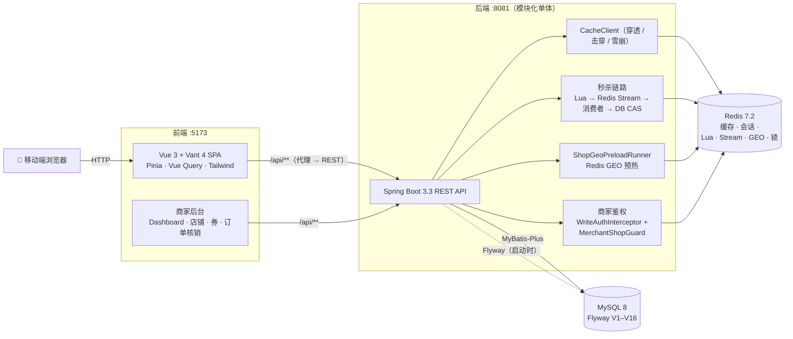

<p align="right"><a href="README.md">English</a> | <a href="README.zh-CN.md"><b>简体中文</b></a></p>

# 🍜 本地生活服务平台（Local Life Service Platform）

一个全栈**本地生活服务平台**——仿大众点评：用户浏览商铺、购买或秒杀优惠券，商家管理自己的店铺、券与核销。
本项目是一个**模块化单体（modular monolith）**：一个 Spring Boot 应用、一个 MySQL、一个 Redis，
外加一个 Vue 3 移动端 Web 客户端。**不引入消息队列，也不做微服务拆分**——这是有意为之（见[项目边界](#-项目边界)）。

项目有两条主线：**消费者侧**聚焦缓存策略、高并发下单与分布式协同；
**商家侧**补上完整的角色鉴权、店铺归属、券管理与订单核销闭环。


[](https://github.com/SHADE-glitch/Local-life-service-platform/actions/workflows/frontend-ci.yml)
[](https://github.com/SHADE-glitch/Local-life-service-platform/actions/workflows/backend-ci.yml)
[](https://github.com/SHADE-glitch/Local-life-service-platform/actions/workflows/e2e-fullstack.yml)

**是什么** — 一个仿大众点评的全栈本地生活服务平台（Spring Boot 模块化单体 + Vue 3 移动端）。

**解决什么** — 覆盖消费者闭环（浏览、购买、秒杀）与商家闭环（店铺、券、核销），涉及缓存、高并发下单与分布式协同。

**怎么跑** — `docker compose up -d --build`，随后打开前端开发服务器。

**去哪看** — 后端地图见 [backend/README.md](backend/README.md)，跑起来见下方[快速开始](#-快速开始)。

---

## 🛒 核心业务闭环

```
用户 ──▶ 商铺 / 优惠券 ──▶ 秒杀 ──▶ 一人一单 ──▶ 数据库
                          (Redis + Lua)   (幂等)        ▲
                                  │                     │
                                  └──▶ 异步持久化 ───────┘
                                       (Redis Stream 消费者)
```

消费者发现商铺（Redis 缓存，GEO 支撑「附近门店」）→ 打开优惠券 → 直接购买或参与秒杀。
秒杀请求在 Redis 内由 Lua 脚本把关（原子库存校验 + 一人一单），立即应答，随后由 Redis Stream
消费者异步落库到 MySQL。后续的支付、取消、退款、核销都通过 CAS 状态机推进。

---

## 🏗️ 系统架构



### 秒杀完整时序

```
Client → seckillVoucher(voucherId)
         │  校验时间窗（DB SeckillVoucher）
         ├─ Redisson 锁 per (userId, voucherId)
         ├─ 冷启动 / 矫正 Redis 库存（与 DB 对比）
         └─ EVALSHA seckill.lua  KEYS[stock,orders] ARGV[userId]
              → {0 成功, -1 库存不足, -2 重复下单}
            成功 → XADD seckill:stream {orderId,userId,voucherId}
                   → 200 {orderId, PENDING_PAYMENT}（异步返回）

Stream 消费者（单线程执行器）
  XREADGROUP lastConsumed block 2s → handleStreamRecord
    DB 幂等 count(*)、CAS stock-1、INSERT 订单、XACK
  空轮询 → XREADGROUP pending 0..（重放未确认消息）
```

---

## ✨ 功能特性

| 领域 | 功能 | 说明 |
|---|---|---|
| 🏪 | **商铺与分类** | Redis 缓存，含穿透 / 击穿 / 雪崩防护；GEO 支撑地图找店 |
| ⚡ | **秒杀优惠券** | Lua 守卫 + Stream 异步落库；DB CAS 扣库存 |
| 🎟️ | **优惠券与订单** | 全生命周期：浏览 → 购买 / 秒杀 → 支付 → 取消 → 退款 → 删除 → 核销（均含库存 / 占位回滚） |
| 🧑‍💼 | **商家经营后台** | 商家身份与店铺归属鉴权；我的店铺、店铺编辑、券创建（普通 / 秒杀）、券修改、我的券、订单查询、核销、经营看板（含下钻） |
| 🗺️ | **地图找店** | 高德地图 + `ShopGeoPreloadRunner` Redis GEO 预热 |
| 📷 | **二维码** | 生成 + 扫码（`qrcode` + `jsqr`） |
| 📝 | **探店笔记（博客）** | 发布 / 详情（作者、店铺、评论）/ 点赞 / 我的笔记列表；商铺详情页聚合展示 |
| 💬 | **商铺评价** | 按店查询 / 评分汇总 / 发表 / 我的评价 / 修改 / 删除 |
| 🔔 | **消息通知** | 消息列表（点赞 / 关注 / 评论）、未读数、标记已读 / 全部已读 |
| 👥 | **关注与个人主页** | 关注 / 取关 / 粉丝列表；他人主页聚合（笔记 + 评价） |
| 🕘 | **浏览历史** | 记录 / 我的历史 / 清空 |
| 📮 | **意见反馈** | 提交 / 我的反馈 / 删除 |
| 📅 | **每日签到** | BitMap 存储，签到 / 连续天数 / 今日状态 |
| 📱 | **移动端 SPA** | Vant 4 + Tailwind CSS 4——首页、博客动态、消息、商家后台、我的、设置 |
| 🔐 | **登录态** | Token 落 Redis（含 `role`），`RefreshTokenInterceptor` + `LoginInterceptor` 链路 |
| 🖼️ | **文件上传** | `UploadController` → 本地 `uploads/icon`（2 MB，jpg / jpeg / png / webp） |
| 🗃️ | **零配置数据库** | Flyway V1–V16 自动建库 + 灌入 45 城 **1,290** 家商铺与 **13,601** 张优惠券（其中 2,682 张为秒杀券，无需手动导 SQL） |
| 🐳 | **Docker 基础设施** | 全栈 Compose，DevTools 热重载 + Vite HMR |

---

## 🌟 核心工程亮点

每个亮点都按 **业务问题 → 技术方案 → 为什么这么设计** 组织。

### 1. 秒杀防超卖与一人一单

- **业务问题。** 秒杀在某一瞬间涌入大量并发请求，库存不能扣成负数，同一用户不能下出两单。
- **技术方案。** 单个 Lua 脚本（`seckill.lua`）原子执行 `GET 库存 → SISMEMBER 占位 → INCRBY -1 → SADD`，
  返回 `0`（成功）/ `-1`（库存不足）/ `-2`（重复下单）。仅当返回 `0` 时，请求才 `XADD` 一条消息到
  Redis Stream 并立即返回。随后由单线程消费者落库：幂等 `count(userId, voucherId)`、
  `stock = stock - 1 WHERE stock > 0` 的 CAS、`INSERT`。`(userId, voucherId)` 上的 DB 唯一键做最后兜底。
- **为什么这么设计。** 原子校验必须放在可变状态所在的地方。Lua 让「读库存、判占位、扣减、标记占位」
  不被其他请求打断。DB 的 CAS 与唯一键则保证：即便 Redis 视图过期，也不会超卖或产生重复单。

### 2. 秒杀既要快，又不能丢单

- **业务问题。** 在请求线程内同步写库，会把流量尖峰变成成片超时与锁竞争。
- **技术方案。** 请求路径只碰 Redis，直接返回 `200 {orderId, PENDING_PAYMENT}`——异步受理。持久化交给
  **Redis Stream 消费组**：`XREADGROUP` 维护消费偏移，`XACK` 只在 DB 写成功后发出；空轮询时扫
  Pending 列表（偏移 `0`）重放未确认消息，对卡在失效消费者上的消息做重新投递；毒消息隔离，
  避免单条坏记录堵住队列。
- **为什么这么设计。** 用 Stream 而不上通用消息中间件是有意的：库存、Lua、Stream 同处一个 Redis，
  热路径只有一跳、只有一个故障域，同时仍然具备投递保障（ACK + Pending 重放）。

### 3. 一个可复用的缓存客户端，覆盖穿透、击穿、雪崩

- **业务问题。** 商铺与优惠券读请求会以三种经典方式打到 DB：查不存在的 key（穿透）、
  热点 key 在高压下过期（击穿）、大批 key 同时过期（雪崩）。
- **技术方案。** 统一收敛到 `CacheClient`，任何 Service 直接委托：
  `handleCachePenetration`（先缓存后 DB，空值哨兵 + `CACHE_NULL_TTL = 2s` 消灭幽灵 key）、
  `handleCacheBreakdownWithMutex`（Redis 锁 `lock:shop:{id}`、10s 租约 + double-check + 阻塞重试）、
  `handleCacheBreakdownWithLogicalExpire`（逻辑过期 `RedisData.expireTime` + 异步重建）、
  `setWithRandomTtl`（`0..300s` 随机抖动错开 TTL）。写操作删除缓存（Cache-Aside）。
- **为什么这么设计。** 三种失效模式同源——缓存未命中时 DB 失去保护——所以用一个统一入口，
  让防护一致，而不是每个 Service 各写一套。

### 4. 每个订单操作都幂等且状态显式

- **业务问题。** 移动网络下重试不可避免：「支付两次」「取消两次」，或秒杀消息被重复消费，
  都不能弄坏订单。
- **技术方案。** 订单沿显式状态机推进（`1` 待支付、`2` 已支付、`3` 已使用、`4` 已取消、
  `5` 已过期、`6` 已退款），每一步都是单行 CAS 更新，状态一旦推进，重复操作即为 no-op。
  通用 `IdempotencyInterceptor` 识别 `Idempotency-Key` 头，用 `SETNX`
  写 `idem:req:{user}:{method}:{uri}:{key}`（5 分钟 TTL），重复请求返回 `409`。秒杀消费者另有
  `count(userId, voucherId)` 兜底。
- **为什么这么设计。** 幂等被表达为「状态迁移 + 请求头契约」，因此能保护整个 API，而不是散落在各接口里。

### 5. 商家鉴权 fail-closed

- **业务问题。** 商家只能操作自己的店铺、券与订单；会话缺失或异常时，绝不能被解读为「放行」。
- **技术方案。** 两层独立校验：身份层（`tb_user.role`，V15——`0` 普通用户 / `1` 商家，由
  `WriteAuthInterceptor` 拦 `/shops/**`、`/vouchers/**` 的非 GET）与归属层（`tb_shop.owner_id`，V16，1:N，
  由 `MerchantShopGuard.assertOwner` 校验）。fail-closed：匿名 → `401 + 10001`、非商家 →
  `403 + 40003`、跨店 → `403 + 40004`，越权订单一律按**「订单不存在」**应答，不泄露存在性。
  前端路由守卫只做 UX，后端才是边界。
- **为什么这么设计。** 身份与归属是两个不同的问题，因此用两套检查。越权时答「不存在」而非
  「禁止」，是为了掐断枚举探测的通道。

### 6. 修复「锁在事务提交前释放」的缺陷

- **业务问题。** 早期实现中分布式锁在方法末尾释放，可能早于外层 DB 事务提交——第二个请求
  可能读到未提交的状态。（记录为 `UF-004`。）
- **技术方案。** 把解锁放进 `TransactionSynchronization.afterCompletion` 回调，只有事务真正结束后才释放。
- **为什么这么设计。** 「锁要持有到它保护的工作真正落定」正是锁存在的意义；把释放绑定到事务完成，
  是保证这一点的唯一方式。

### 7. 快速「附近门店」且不打爆数据库

- **业务问题。** 地图页要按分类 + 城市过滤并按距离排序，逐请求在关系表上实时计算代价高。
- **技术方案。** `ShopGeoPreloadRunner`（`ApplicationRunner`）在启动时把 `tb_shop(x, y)` 按
  `shop:geo:{typeId}:{city}` 灌入 Redis GEO 集合。地图页做半径（50 km）查询，带距离排序与分页；
  未命中预热集时降级走 DB 路径的 Haversine 扫描。
- **为什么这么设计。** 访问模式是「读多写少、按分类 + 城市过滤」，正是预热型地理索引擅长的事，
  同时保留缓存冷启动时的正确性兜底。

---

## 🧰 技术栈

| 层级 | 技术 |
|---|---|
| **后端** | Java 17 · Spring Boot 3.3.5 · MyBatis-Plus 3.5.7 · Flyway（V1–V16）· Redisson 3.37.0（`RLock.tryLock`）· Hutool 5.8.40 · Lombok · Spring Actuator · Micrometer Prometheus · JaCoCo 0.8.13 |
| **存储** | MySQL 8（业务数据）· Redis 7.2（缓存 / Stream `SECKILL_STREAM_KEY` / GEO `SHOP_GEO_KEY` / 会话令牌 / 锁；开启 AOF） |
| **前端** | Vue 3.5 · TypeScript 6.0 · Vite 8 · Vant 4.9 · Tailwind CSS 4 · Pinia 3（+ persistedstate）· Vue Router 5 · TanStack Vue Query 5 · Axios · `qrcode` / `jsqr` |
| **测试** | 后端：JUnit 5 · AssertJ · MockMvc · 真实并发压测 · 52 项 API 冒烟脚本；前端：Vitest 4（120 用例 / 9 文件）· Vue Test Utils · MSW · Playwright 1.54（9 spec）· ESLint 10 / Prettier 3 |
| **基础设施** | Docker Compose（MySQL、Redis、热重载后端、前端开发服务器）· GitHub Actions CI |

---

## 🚀 快速开始

### 环境要求

- [Docker](https://docs.docker.com/get-docker/) + Docker Compose
- Git

### 1. 配置环境变量

```bash
git clone https://github.com/SHADE-glitch/Local-life-service-platform.git
cd Local-life-service-platform
cp .env.example .env
```

按需修改 `.env`——默认值可直接配合 Docker Compose 使用。

### 2. 一键启动

```bash
docker compose up -d --build
```

| 服务 | 端口 | 说明 |
|---|---|---|
| frontend | `5173` | Vite HMR |
| backend | `8081` | Maven + DevTools 热重载 |
| mysql | `3306` | 首次启动由 Flyway 自动建库 |
| redis | `6379` | 已开启 AOF |

### 3. 访问应用

- **Web 应用：** http://localhost:5173
- **健康检查：** http://localhost:8081/actuator/health

> ℹ️ 首次启动需几分钟（Maven 拉依赖 + Flyway 建库），无需手动导 SQL。

### 不用 Docker 本地运行

<details>
<summary><b>手动部署</b>：需 JDK 17、Maven 3.9+、Node 20+、本机 MySQL 8 与 Redis 7</summary>

1. 自行准备 MySQL 与 Redis（如 `docker compose up -d mysql redis`，或本机安装）。
2. 修改 `.env`，把主机地址改成本机：将 `mysql:` / `redis:` 替换为 `127.0.0.1:`，并将 `VITE_PROXY_TARGET` 改为 `http://localhost:8081`。
3. 启动后端：`cd backend && mvn spring-boot:run`
4. 启动前端：`cd frontend && npm ci && npm run dev`

</details>

---

## ⚙️ 配置说明

所有运行时配置集中在 `.env`（不会提交到仓库），完整模板见 [`.env.example`](.env.example)。

| 变量 | 示例值 | 说明 |
|---|---|---|
| `TZ` | `Asia/Shanghai` | 时区 |
| `SERVER_PORT` | `8081` | 后端宿主机映射 |
| `MYSQL_PORT` / `REDIS_PORT` / `VITE_DEV_PORT` | `3306` / `6379` / `5173` | 各服务宿主机端口 |
| `MYSQL_ROOT_PASSWORD` | *（自行设置）* | 须与 `SPRING_DATASOURCE_PASSWORD` 一致 |
| `MYSQL_DATABASE` | `hmdp` | 自动创建 |
| `SPRING_DATASOURCE_URL` | `jdbc:mysql://mysql:3306/hmdp?...` | 本地运行改 `127.0.0.1:<MYSQL_PORT>` |
| `SPRING_DATASOURCE_USERNAME` / `_PASSWORD` | `root` / *（自行设置）* | 数据库凭据 |
| `SPRING_REDIS_HOST` / `SPRING_REDIS_PORT` | `redis` / `6379` | Docker 内为 `redis`，本地为 `127.0.0.1` |
| `HMDP_UPLOAD_DIR` | `uploads/icon` | 上传目录 |
| `VITE_PROXY_TARGET` | `http://backend:8081` | Vite 代理目标 |
| `VITE_AMAP_KEY` / `VITE_AMAP_SECURITY_CODE` | *（到 lbs.amap.com 申请）* | 高德地图 |

> `.env.example` 中标注 `[SECRET]` 的变量请替换为真实值，其余开箱即用。

---

## 🧪 测试

以下数字来自 `backend/test-results/` 的落盘产物。每个数字都连同其测试条件一起引用。

| 套件 | 规模 | 说明 |
|---|---|---|
| JUnit（后端） | 由 `mvn -B test` 打印 | 基于 `@SpringBootTest` 直连真实 MySQL/Redis，**不是隔离容器**，所以每次执行都配一次库存对账 |
| API 冒烟 | **52 项** | `bash backend/tests/api-crud-smoke.sh`（需后端已启动） |
| Vitest（前端） | **120 用例 / 9 文件** | `npm run test` |
| Playwright（前端） | **9 spec** | 消费者 + 商家全链路 |

### 秒杀并发结果（引用轮）

测试条件：**100 用户、并发 10、库存 50**（`voucherId=30003`），**单机本地 Docker**。
引用轮：**50 成功 / 50 被拒**、**0 超卖**、**0 重复下单**，P50 **11.8 ms** / P95 **14.1 ms** / P99 **14.9 ms**。

两处需要留意：

- 那 50 次失败是**预期的业务拒绝** `30001 库存不足`，不是错误。
- 缓存读数字与轮次强相关：`ab -n 500 -c 10 /shops/1` 在 2026-09-19 测得 **3763.81 RPS**，
  在 2026-09-20 测得 **5152.46 RPS**；另一组各 20 样本的 curl 对比显示，命中缓存后中位耗时约降一半
  （回源 **7.9 ms** → 命中 **4.0 ms**）。要引用就带轮次，别只取一个标题数字。

以上均为本机单机结果，不是生产级压测。

---

## 📚 项目文档

| 文档 | 内容 |
|---|---|
| [backend/README.md](backend/README.md) | 后端地图：包职责、Redis 键、HTTP 面与测试入口 |

---

## 🧭 项目边界

- **架构：** **模块化单体**——一个 Spring Boot 应用、一个部署单元，**有意不做**微服务拆分。
- **消息中间件：** **不使用任何消息队列。** 秒杀异步持久化使用 **Redis Stream**（消费组 + ACK + Pending 重放），
  选它是为了让热路径留在同一个 Redis 内。
- **数据：** 表结构与种子数据完全由 Flyway 迁移管理（无零散 `sql/` 文件）。
- **数字口径：** 所有性能数字均来自**单机本地 Docker**，不是生产级压测。
- **演示提示：** 没有提权接口，Demo 前需用 SQL 把演示账号置为商家；种子消费者账号 `13686869696` 为 `role=0`。
- **前端：** 为打通接口而写的演示壳；进入简历的是后端。

---

## 📊 项目状态

- 消费者与商家两条链路的后端 API 均已完备。
- 商家端 4 个页面已接入（看板、店铺、券、订单）；`/merchant/*` 路由均带 `requiresMerchant: true`。
- 后端及其亮点行为已锁定。

---

## 🙏 致谢

本项目基于[黑马程序员（itheima）](https://www.bilibili.com/video/BV1cr4y1671t)的精品课程项目
[黑马点评（hm-dianping）](https://www.bilibili.com/video/BV1cr4y1671t)，并在其基础上大幅重构：
Flyway 管理的数据库迁移、Redisson 分布式锁、Redis Stream 异步秒杀、商家角色与店铺归属体系、
全新重写的 Vue 3 + TypeScript 客户端，以及容器化开发基础设施。

## 📄 许可证

暂未添加 License 文件。在添加之前，版权归作者所有。
